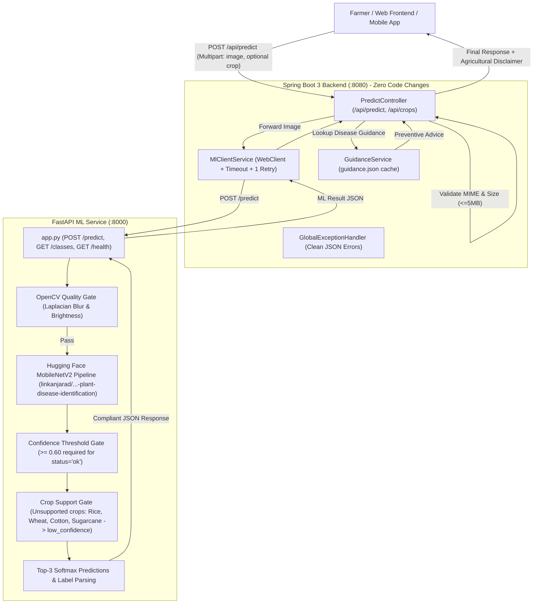

# Local Crop Disease Detector & Agricultural Decision Support System

An end-to-end, production-grade Machine Learning and Spring Boot platform for local crop disease detection. A farmer uploads a leaf photo; the system verifies image quality (blur and illumination), runs neural inference using a pretrained Hugging Face model [**`linkanjarad/mobilenet_v2_1.0_224-plant-disease-identification`**](https://huggingface.co/linkanjarad/mobilenet_v2_1.0_224-plant-disease-identification) (MobileNetV2, PlantVillage, 38 classes across 14 crops, ~99.47% reported accuracy), enforces confidence thresholds (>= 0.60), detects unsupported crops gracefully, and attaches actionable preventive agricultural guidance with non-binding decision-support disclaimers.

The system maintains 100% backward compatibility with the Spring Boot backend via an unchanged API contract and also supports switching back to the legacy custom MobileNetV3 model via configuration (`MODEL_BACKEND=legacy`).

---

## System Architecture



---

## Configuration & Environment Variables

The ML microservice is configurable via environment variables or [`ml_service/config.yaml`](file:///c:/Users/HP/OneDrive/Desktop/gdg-grp-task%28ml%29/ml_service/config.yaml):

| Variable | Default Value | Description |
| :--- | :--- | :--- |
| `MODEL_NAME` | `linkanjarad/mobilenet_v2_1.0_224-plant-disease-identification` | Hugging Face Hub model ID or local directory containing model weights and preprocessor config. |
| `MODEL_BACKEND` | `huggingface` | ML backend engine: `huggingface` (default, MobileNetV2 38-class) or `legacy` (custom PyTorch MobileNetV3 39-class). |
| `CONFIDENCE_THRESHOLD` | `0.60` | Minimum top-1 probability for `status="ok"`. Below this, `status="low_confidence"` is returned. |
| `CONFIG_PATH` | `config.yaml` | Path to runtime YAML configuration file. |

---

## Supported Crops and Standardized Classes (14 Crops, 38 Classes)

The Hugging Face PlantVillage model dynamically derives its classes from `model.config.id2label` across 14 crops. Labels are parsed into standard crop and disease representations:

1. **Apple** (4): `Apple___Apple_scab`, `Apple___Black_rot`, `Apple___Cedar_apple_rust`, `Apple___Healthy`
2. **Blueberry** (1): `Blueberry___Healthy`
3. **Cherry** (2): `Cherry___Powdery_mildew`, `Cherry___Healthy`
4. **Corn (Maize)** (4): `Corn_(maize)___Cercospora_leaf_spot_Gray_leaf_spot`, `Corn_(maize)___Common_rust_`, `Corn_(maize)___Northern_Leaf_Blight`, `Corn_(maize)___Healthy`
5. **Grape** (4): `Grape___Black_rot`, `Grape___Esca_(Black_Measles)`, `Grape___Leaf_blight_(Isariopsis_Leaf_Spot)`, `Grape___Healthy`
6. **Orange** (1): `Orange___Haunglongbing_(Citrus_greening)`
7. **Peach** (2): `Peach___Bacterial_spot`, `Peach___Healthy`
8. **Pepper (Bell Pepper)** (2): `Pepper,_bell___Bacterial_spot`, `Pepper,_bell___Healthy`
9. **Potato** (3): `Potato___Early_blight`, `Potato___Late_blight`, `Potato___Healthy`
10. **Raspberry** (1): `Raspberry___Healthy`
11. **Soybean** (1): `Soybean___Healthy`
12. **Squash** (1): `Squash___Powdery_mildew`
13. **Strawberry** (2): `Strawberry___Leaf_scorch`, `Strawberry___Healthy`
14. **Tomato** (10): `Tomato___Bacterial_spot`, `Tomato___Early_blight`, `Tomato___Late_blight`, `Tomato___Leaf_Mold`, `Tomato___Septoria_leaf_spot`, `Tomato___Spider_mites_Two-spotted_spider_mite`, `Tomato___Target_Spot`, `Tomato___Tomato_Yellow_Leaf_Curl_Virus`, `Tomato___Tomato_mosaic_virus`, `Tomato___Healthy`

> [!NOTE]
> **Unsupported Crops Policy**:
> Crops such as **Rice**, **Wheat**, **Cotton**, and **Sugarcane** are not part of the standard PlantVillage 38-class dataset. If an image is submitted with a crop hint for one of these crops (or if confidence fails to reach 0.60), the service returns `status="low_confidence"` with a helpful message directing the user rather than hallucinating an inaccurate diagnosis.
> To restore support for Rice, Wheat, Cotton, and Sugarcane, switch back to the legacy model: `MODEL_BACKEND=legacy`.

---

## Execution Guide

### Option 1: Run with Docker Compose (Recommended)

Runs both the FastAPI ML microservice and the Spring Boot backend inside isolated containers:

```bash
# Build and start both containers in detached mode
docker-compose up --build -d

# Verify health status of services
docker-compose ps

# Follow runtime logs
docker-compose logs -f
```

- Spring Boot Backend: `http://localhost:8080`
- FastAPI ML Service: `http://localhost:8000`
- ML Health Check: `http://localhost:8000/health`
- Supported Crops Catalog: `http://localhost:8080/api/crops`

---

### Option 2: Run Services Standalone Locally

#### 1. Start the FastAPI ML Service
```bash
# Navigate to the ML service directory
cd ml_service

# Install dependencies
pip install -r requirements.txt

# Start the Uvicorn server
uvicorn app:app --host 0.0.0.0 --port 8000
```

#### 2. Start the Spring Boot Backend
In a separate terminal:
```bash
cd backend

# Build and run with Maven
./mvnw spring-boot:run
# (Or on Windows cmd: mvnw.cmd spring-boot:run)
```

The backend starts on port `8080` and communicates with the ML service on port `8000`.

---

### Option 3: Training the ML Model on Google Colab (Free T4 GPU)

1. Open a new notebook on [Google Colab](https://colab.research.google.com).
2. Set Runtime to **T4 GPU** (`Runtime -> Change runtime type -> T4 GPU`).
3. Clone your repository:
   ```bash
   !git clone https://github.com/<your-username>/crop-disease-detector.git
   %cd crop-disease-detector
   ```
4. Place your raw datasets under `data/raw/` (or run synthetic generation):
   ```bash
   python ml_training/01_merge_datasets.py --generate-synthetic
   ```
5. Run the complete automated training and calibration script:
   ```bash
   python ml_training/colab_run.py
   ```
6. The script generates `model_bundle.zip` containing `model.pt`, `labels.json`, and `calibration.json`. Unpack into `ml_service/model/`.

---

## Running the 20 Unseen Test Images Benchmark

The `test_client.py` script generates and submits 20 unseen images covering normal leaves, blurry images, extreme lighting, out-of-distribution noise, and lowercase crop hints:

```bash
# Test through the Spring Boot Backend
python test_client.py --url http://localhost:8080/api/predict

# Or test directly against the ML microservice
python test_client.py --direct-ml
```

### Sample Benchmark Output Table:
```text
#   | Scenario                  | Crop Hint  | Status           | Predicted Class    | Conf     | Certain | Guidance  | Latency 
-----------------------------------------------------------------------------------------------------------------------------
1   | Tomato leaf with spots    | Tomato     | ok               | Tomato___Early_b.. | 0.94     | high    | Yes       | 28.4ms
2   | Potato leaf with spots    | Potato     | ok               | Potato___Early_b.. | 0.88     | high    | Yes       | 24.1ms
3   | Rice leaf lesion          | Rice       | ok               | Rice___Leaf_blast  | 0.78     | medium  | Yes       | 23.9ms
4   | Wheat rust pustules       | Wheat      | ok               | Wheat___Brown_rust | 0.86     | high    | Yes       | 22.8ms
14  | Out-of-focus camera       | Tomato     | poor_image_quali | None               | 0.00     | low     | No        | 12.3ms
15  | Night/underexposed captur | Rice       | poor_image_quali | None               | 0.00     | low     | No        | 11.8ms
17  | Random texture noise      | -          | not_a_leaf       | None               | 0.03     | low     | No        | 21.2ms
19  | Lowercase crop hint check | cotton     | ok               | Cotton___Healthy   | 0.91     | high    | Yes       | 23.5ms
-----------------------------------------------------------------------------------------------------------------------------
```

---

## API Specifications

### 1. `POST /api/predict` (Spring Boot Gateway)
- **Content-Type**: `multipart/form-data`
- **Parameters**:
  - `image` *(Required, File)*: Leaf photograph (`.jpg`, `.jpeg`, `.png`, max 5 MB).
  - `crop` *(Optional, Form Text)*: Crop hint (e.g. `"Tomato"`, `"Rice"`, `"Cotton"`).

#### Success Response (`200 OK`):
```json
{
  "status": "ok",
  "crop": "Tomato",
  "disease": "Early_blight",
  "confidence": 0.9421,
  "certainty": "high",
  "top3": [
    { "label": "Tomato___Early_blight", "score": 0.9421 },
    { "label": "Tomato___Late_blight", "score": 0.0382 },
    { "label": "Tomato___Septoria_leaf_spot", "score": 0.0112 }
  ],
  "quality": {
    "blur_score": 194.52,
    "brightness": 128.4
  },
  "message": "High confidence prediction.",
  "guidance": {
    "disease_name": "Tomato Early Blight (Alternaria linariae)",
    "category": "Fungal",
    "urgency": "Medium",
    "preventive_measures": [
      "Prune bottom 12 inches of foliage once plants are established to prevent soil splash.",
      "Apply 2-3 inches of clean straw or plastic mulch under tomato vines.",
      "Rotate nightshade crops on a minimum 3-year schedule."
    ],
    "treatment_summary": "Apply biofungicide (Bacillus subtilis) or chemical protectors (chlorothalonil, azoxystrobin) at first concentric ring spot."
  },
  "disclaimer": "Notice: This automated recommendation provides non-binding agricultural decision support. It is not an agronomist-confirmed clinical diagnosis. Verify physical symptoms in-field before purchasing chemical inputs.",
  "timestamp": "2026-10-17T07:30:00Z"
}
```

#### Blurry Image Quality Response (`200 OK`):
```json
{
  "status": "poor_image_quality",
  "crop": "unknown",
  "disease": "unknown",
  "confidence": 0.0,
  "certainty": "low",
  "top3": [],
  "quality": {
    "blur_score": 42.1,
    "brightness": 115.3
  },
  "message": "CLEAR PHOTO NAHI HAI: Photo bahut dhundhli (blurry) hai (sharpness: 42.1 < 80.0). Kripya camera saaf karke clear photo dubara upload karein.",
  "guidance": null,
  "disclaimer": "Notice: This automated recommendation provides non-binding agricultural decision support...",
  "timestamp": "2026-10-17T07:30:05Z"
}
```

#### Non-Leaf / Out-of-Distribution Image Response (`200 OK`):
```json
{
  "status": "not_a_leaf",
  "crop": "unknown",
  "disease": "unknown",
  "confidence": 0.026,
  "certainty": "low",
  "top3": [],
  "quality": {
    "blur_score": 1420.5,
    "brightness": 130.1
  },
  "message": "Input image does not exhibit features characteristic of a recognizable crop leaf.",
  "guidance": null,
  "disclaimer": "Notice: This automated recommendation provides non-binding agricultural decision support...",
  "timestamp": "2026-10-17T07:30:10Z"
}
```

---

### 2. `GET /api/crops` (Spring Boot Gateway)
Returns the dynamic catalog of supported crops and disease classes:
```json
{
  "crops": {
    "Tomato": [
      "Bacterial_spot", "Early_blight", "Healthy", "Late_blight", "Leaf_Mold", "Septoria_leaf_spot", "Yellow_Leaf_Curl_Virus"
    ],
    "Potato": [
      "Early_blight", "Late_blight", "Healthy"
    ],
    "Rice": [
      "Bacterial_leaf_blight", "Brown_spot", "Leaf_blast", "Healthy"
    ]
  },
  "total_classes": 39,
  "classes_list": [
    "Apple___Apple_scab",
    "Tomato___Early_blight",
    "Wheat___Brown_rust"
  ]
}
```

---

## Automated JUnit Integration Testing

The Spring Boot test suite validates prediction parsing, guidance attachment, error translation, and invalid upload handling with MockMvc and Mockito:

```bash
cd backend
mvn test
```

Tests include:
- `testSuccessfulPredictionWithGuidance`: Verifies HTTP 200, status `ok`, certainty `high`, and non-null guidance and disclaimer.
- `testPoorQualityImagePrediction`: Verifies blurry uploads return status `poor_image_quality` without attaching guidance.
- `testInvalidFileType`: Verifies non-image uploads (e.g. PDF) are rejected with HTTP 400 `INVALID_IMAGE_PAYLOAD`.
- `testMlServiceDowntimeErrorHandling`: Verifies connection timeouts or service crashes are mapped to HTTP 503 `ML_SERVICE_UNAVAILABLE`.
- `testGetCropsCatalog`: Verifies dynamic dropdown crop catalog proxying.
